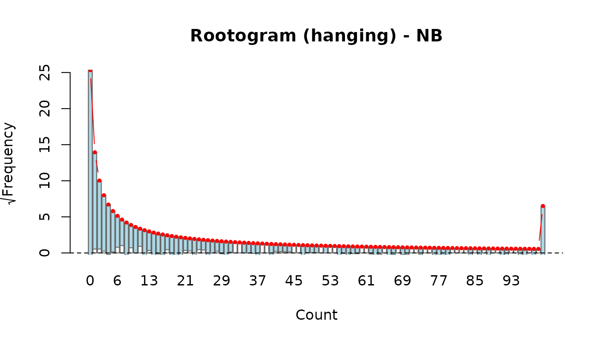
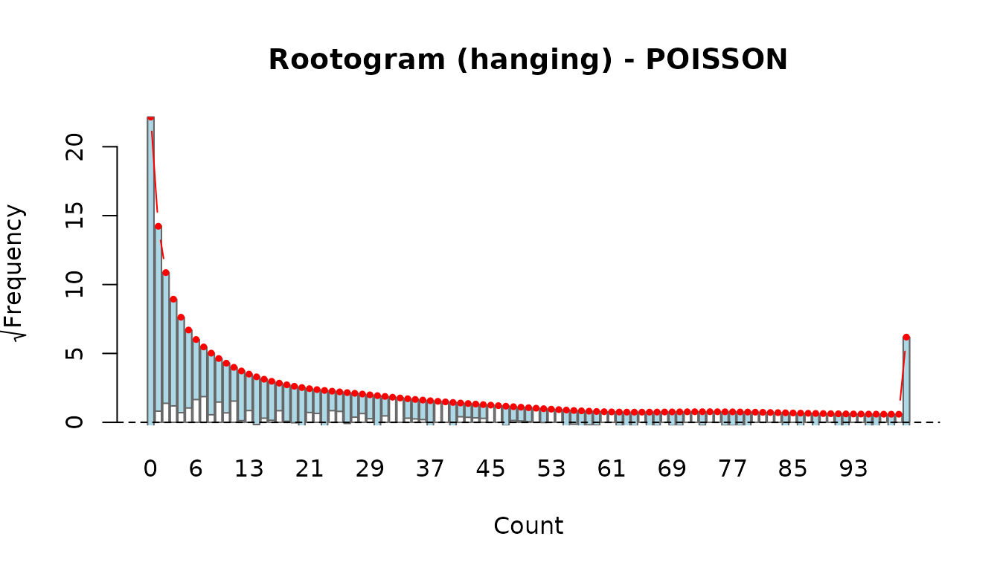
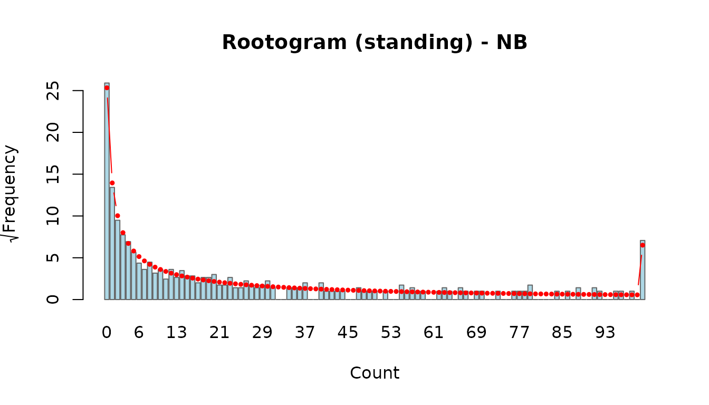
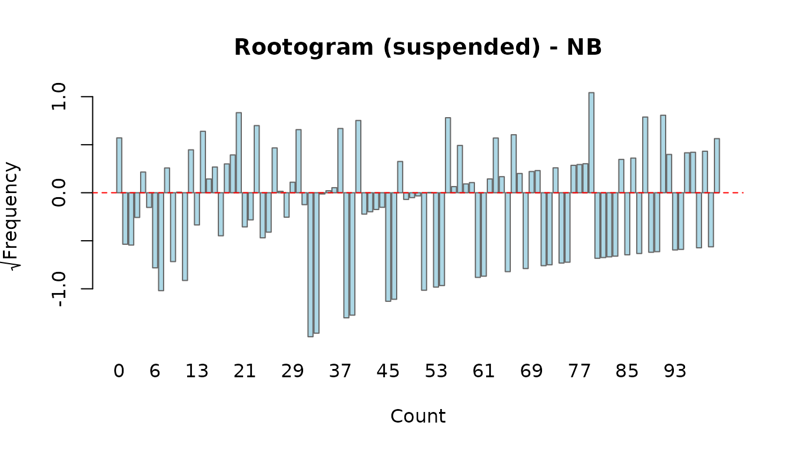
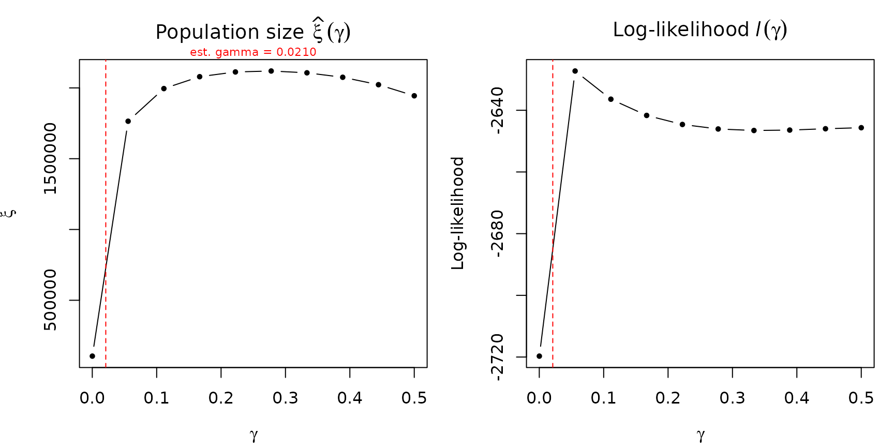
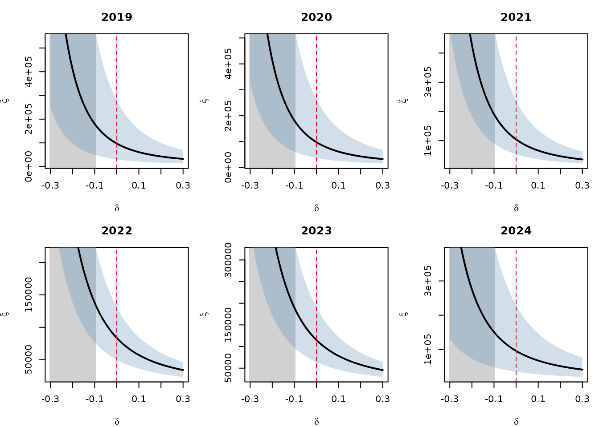

# Model Diagnostics and Comparison

This vignette demonstrates the diagnostic and model-comparison tools
available in the **uncounted** package. We cover goodness-of-fit
statistics, residual analysis, rootograms, exploratory log-log plots,
leave-one-out sensitivity analysis, and gamma profiling. Together these
tools help you decide which model specification is most appropriate and
whether the population-size estimates are robust.

## 1. Setup: fitting Poisson and Negative Binomial models

We use the `irregular_migration` dataset shipped with the package. Two
models are fitted—Poisson and Negative Binomial—with year and sex
covariates on alpha and year covariates on beta.

``` r

library(uncounted)
data(irregular_migration)

fit_po <- estimate_hidden_pop(
  data = irregular_migration,
  observed = ~ m, auxiliary = ~ n, reference_pop = ~ N,
  method = "poisson",
  cov_alpha = ~ factor(year) + sex, cov_beta = ~ factor(year),
  countries = ~ country_code
)

fit_nb <- estimate_hidden_pop(
  data = irregular_migration,
  observed = ~ m, auxiliary = ~ n, reference_pop = ~ N,
  method = "nb",
  cov_alpha = ~ factor(year) + sex, cov_beta = ~ factor(year),
  countries = ~ country_code
)
```

Quick summaries:

``` r

summary(fit_po)
#> Unauthorized population estimation
#> Method: POISSON | estimator: MLE | link_rho: power | vcov: HC3 
#> N obs: 1382 
#> Gamma: 0.007257 (estimated) 
#> Log-likelihood: -8217.24 
#> AIC: 16462.49  BIC: 16535.73 
#> Deviance: 13831.69 
#> 
#> Coefficients:
#>                          Estimate Std. Error z value  Pr(>|z|)    
#> alpha:(Intercept)       0.7887596  0.0903273  8.7322 < 2.2e-16 ***
#> alpha:factor(year)2020  0.0014537  0.0959447  0.0152  0.987911    
#> alpha:factor(year)2021 -0.0172363  0.0872209 -0.1976  0.843345    
#> alpha:factor(year)2022 -0.0934949  0.1092305 -0.8559  0.392031    
#> alpha:factor(year)2023 -0.1134964  0.1773040 -0.6401  0.522092    
#> alpha:factor(year)2024 -0.1689875  0.1612254 -1.0481  0.294572    
#> alpha:sexMale           0.0420096  0.0458804  0.9156  0.359860    
#> beta:(Intercept)        0.6750538  0.1947567  3.4661  0.000528 ***
#> beta:factor(year)2020   0.1894950  0.2273955  0.8333  0.404660    
#> beta:factor(year)2021   0.2338181  0.2124527  1.1006  0.271086    
#> beta:factor(year)2022   0.0892652  0.2486466  0.3590  0.719592    
#> beta:factor(year)2023  -0.0518049  0.3783833 -0.1369  0.891101    
#> beta:factor(year)2024  -0.3221328  0.3184801 -1.0115  0.311792    
#> ---
#> Signif. codes:  0 '***' 0.001 '**' 0.01 '*' 0.05 '.' 0.1 ' ' 1
#> 
#> -----------------------
#> Population size estimation results:
#>   (BC = bias-corrected using model-based variance)
#>                       Observed Estimate Estimate (BC) CI lower CI upper
#> year=2019, sex=Female    1,535   21,086        21,054    3,400  130,357
#> year=2019, sex=Male      5,069   59,948        59,865   10,219  350,697
#> year=2020, sex=Female      698   23,647        23,582    6,023   92,324
#> year=2020, sex=Male      2,700   66,768        66,577   22,931  193,299
#> year=2021, sex=Female      483   22,769        22,704    7,266   70,941
#> year=2021, sex=Male      2,622   65,095        64,901   32,339  130,248
#> year=2022, sex=Female      317   14,118        14,082    2,476   80,080
#> year=2022, sex=Male      2,632   32,920        32,843    7,365  146,448
#> year=2023, sex=Female      523   12,068        12,047      533  272,106
#> year=2023, sex=Male      3,839   28,848        28,804    1,219  680,547
#> year=2024, sex=Female      956    7,111         7,104      576   87,598
#> year=2024, sex=Male      5,731   17,475        17,461    1,176  259,267
summary(fit_nb)
#> Unauthorized population estimation
#> Method: NB | estimator: MLE | link_rho: power | vcov: HC1 
#> N obs: 1382 
#> Gamma: 0.02096 (estimated) 
#> Theta (NB dispersion): 1.3556 
#> Log-likelihood: -2621.12 
#> AIC: 5272.23  BIC: 5350.7 
#> Deviance: 1276.1 
#> 
#> Coefficients:
#>                         Estimate Std. Error z value  Pr(>|z|)    
#> alpha:(Intercept)       0.816423   0.034346 23.7708 < 2.2e-16 ***
#> alpha:factor(year)2020 -0.042599   0.057044 -0.7468 0.4552054    
#> alpha:factor(year)2021  0.074765   0.059647  1.2535 0.2100378    
#> alpha:factor(year)2022 -0.030640   0.073431 -0.4173 0.6764887    
#> alpha:factor(year)2023  0.014987   0.055947  0.2679 0.7887861    
#> alpha:factor(year)2024  0.069038   0.047778  1.4450 0.1484639    
#> alpha:sexMale           0.044355   0.013144  3.3746 0.0007394 ***
#> beta:(Intercept)        0.874992   0.092533  9.4560 < 2.2e-16 ***
#> beta:factor(year)2020   0.139329   0.116766  1.1932 0.2327759    
#> beta:factor(year)2021   0.467189   0.121614  3.8416 0.0001223 ***
#> beta:factor(year)2022   0.183987   0.151630  1.2134 0.2249786    
#> beta:factor(year)2023   0.182874   0.110517  1.6547 0.0979836 .  
#> beta:factor(year)2024   0.131714   0.092840  1.4187 0.1559805    
#> ---
#> Signif. codes:  0 '***' 0.001 '**' 0.01 '*' 0.05 '.' 0.1 ' ' 1
#> 
#> -----------------------
#> Population size estimation results:
#>   (BC = bias-corrected using model-based variance)
#>                       Observed Estimate Estimate (BC) CI lower CI upper
#> year=2019, sex=Female    1,535   28,104        25,768   12,733   52,147
#> year=2019, sex=Male      5,069   83,167        75,866   35,801  160,765
#> year=2020, sex=Female      698   19,950        18,056    6,724   48,490
#> year=2020, sex=Male      2,700   57,320        51,550   18,776  141,529
#> year=2021, sex=Female      483   82,820        72,696   24,240  218,014
#> year=2021, sex=Male      2,622  257,145       224,052   71,913  698,056
#> year=2022, sex=Female      317   38,071        34,481    7,929  149,957
#> year=2022, sex=Male      2,632   89,818        82,008   20,889  321,959
#> year=2023, sex=Female      523   66,664        60,739   20,285  181,867
#> year=2023, sex=Male      3,839  159,224       146,471   52,775  406,517
#> year=2024, sex=Female      956  120,797       111,073   46,514  265,233
#> year=2024, sex=Male      5,731  302,887       280,588  121,122  650,001
```

## 2. Model comparison

### Comparison table

[`compare_models()`](https://ncn-foreigners.github.io/uncounted/reference/compare_models.md)
produces a side-by-side table of log-likelihood, AIC, BIC, deviance,
Pearson chi-squared, RMSE, and three pseudo $`R^2`$ measures:

- **`R2_cor`**: $`\mathrm{cor}(m, \hat\mu)^2`$ — squared correlation
  between observed and fitted values.
- **`R2_D`**: Explained deviance
  $`1 - D(\text{model}) / D(\text{null})`$, where the null model is the
  same specification without covariates (single $`\alpha`$, single
  $`\beta`$). Measures how much covariates improve the fit beyond the
  baseline power-law structure.
- **`R2_CW`**: Cameron–Windmeijer (1996) pseudo $`R^2`$, which uses the
  model-implied variance function $`V(\mu)`$ — specifically designed for
  count data regression.

Models are sorted by AIC (the default). Note that `R2_D` compares the
fitted model against a null model (same method, no covariates). If the
model has no `cov_alpha` / `cov_beta`, then `R2_D = 0` by construction —
it only becomes informative when covariates are present.

``` r

comp <- compare_models(Poisson = fit_po, NB = fit_nb, sort_by = "AIC")
comp
#> Model comparison
#> ------------------------------------------------------------ 
#>    Model  Method Estimator  Link Constrained n_par   logLik      AIC      BIC
#>       NB      NB       MLE power       FALSE    15 -2621.12  5272.23  5350.70
#>  Poisson POISSON       MLE power       FALSE    14 -8217.24 16462.49 16535.73
#>  Deviance Pearson_X2   RMSE R2_cor    R2_D  R2_CW
#>   1276.10    3089.37 206.08 0.4064 -0.0031 0.9526
#>  13831.69   17499.16  52.53 0.8279  0.3139 0.9827
```

Lower AIC and BIC values indicate a better trade-off between fit and
complexity. The Pearson chi-squared statistic divided by its degrees of
freedom (approximately `n_obs - n_par`) gives a quick dispersion check:
values much greater than 1 suggest overdispersion, which favours the NB
model over Poisson.

### Likelihood ratio test

Because the Poisson model is nested within the Negative Binomial (the
Poisson is the NB with theta -\> infinity), we can use a likelihood
ratio test.
[`lrtest()`](https://ncn-foreigners.github.io/uncounted/reference/lrtest.md)
applies the boundary correction of Self & Liang (1987) automatically
when comparing Poisson against NB, because the dispersion parameter lies
on the boundary of the parameter space under H0.

``` r

lrtest(fit_po, fit_nb)
#> Likelihood ratio test
#> ---------------------------------------- 
#> Model 1: POISSON   (logLik = -8217.24 )
#> Model 2: NB   (logLik = -2621.12 )
#> LR statistic: 11192.26 on 1 df
#> (Boundary-corrected: 0.5 * chi2_0 + 0.5 * chi2_1, Self & Liang 1987)
#> p-value: < 2.2e-16
```

A small p-value indicates significant overdispersion, favouring the NB
model.

Comparing two Poisson models is different. With overdispersion their LR
statistic is not chi-squared and the test rejects far too often.
[`lrtest()`](https://ncn-foreigners.github.io/uncounted/reference/lrtest.md)
reports the Pearson dispersion and notes when it is high. In that case
use the robust Wald test, `lrtest(fit_small, fit_large, test = "Wald")`,
which tests the larger model’s extra coefficients with its sandwich
covariance.

## 3. Residual diagnostics

### Residual types

The [`residuals()`](https://rdrr.io/r/stats/residuals.html) method
supports four types:

- **response**: raw residuals, $`m_i - \hat\mu_i`$.
- **pearson**: standardised by the variance function,
  $`(m_i - \hat\mu_i) / \sqrt{V(\hat\mu_i)}`$.
- **deviance**: signed square root of individual deviance contributions.
- **anscombe**: variance-stabilising residuals (approximately standard
  normal for a well-specified model).

``` r

r_resp <- residuals(fit_nb, type = "response")
r_pear <- residuals(fit_nb, type = "pearson")
r_dev  <- residuals(fit_nb, type = "deviance")
r_ansc <- residuals(fit_nb, type = "anscombe")

summary(r_pear)
#>     Min.  1st Qu.   Median     Mean  3rd Qu.     Max. 
#> -1.15150 -0.59499 -0.28870  0.03629  0.11049 22.90321
summary(r_ansc)
#>     Min.  1st Qu.   Median     Mean  3rd Qu.     Max. 
#> -24.1705  -1.0760  -0.4674  -0.3349   0.1768   9.4248
```

### Four-panel diagnostic plot

[`plot()`](https://rdrr.io/r/graphics/plot.default.html) on a fitted
model produces the Zhang (2008) four-panel display:

1.  **Fitted vs Observed (sqrt scale)** – points should cluster around
    the 45-degree line.
2.  **Anscombe residuals vs fitted** – the running mean should be flat
    near zero (no systematic misfit).
3.  **Scale-Location** – absolute Anscombe residuals vs fitted; an
    increasing trend signals under-modelled variance.
4.  **Normal Q-Q** – Anscombe residuals should follow the reference line
    if the distributional assumption holds.

``` r

op <- par(mfrow = c(2, 2))
plot(fit_nb, ask = FALSE)
```


``` r

par(op)
```

**What to look for:**

- Curvature in Panel 1 suggests the mean function is misspecified.
- A non-flat smoother in Panel 2 indicates systematic bias at certain
  fitted-value ranges.
- A fan shape in Panel 3 points to overdispersion or heteroscedasticity.
- Heavy tails or S-shapes in Panel 4 indicate departure from the assumed
  distribution.

Compare with the Poisson fit to see whether switching to NB resolves any
patterns:

``` r

op <- par(mfrow = c(2, 2))
plot(fit_po, ask = FALSE)
```


``` r

par(op)
```

## 4. Rootograms

Rootograms (Kleiber & Zeileis, 2016) compare the observed and fitted
count-frequency distributions directly. Three display styles are
available:

- **hanging** (default): observed bars are hung from the fitted curve.
  If the model fits well, the bottom of each bar touches zero.
- **standing**: observed bars stand on the x-axis with the fitted curve
  overlaid. Harder to judge discrepancies visually.
- **suspended**: plots the difference
  $`\sqrt{f_\text{obs}} - \sqrt{f_\text{exp}}`$ directly. Bars crossing
  zero indicate over- or under-prediction at that count.

``` r

rootogram(fit_nb, style = "hanging")
```



``` r

rootogram(fit_po, style = "hanging")
```



Compare the two: if the Poisson rootogram shows bars consistently
hanging below the zero line at small counts and above at moderate
counts, this is a classic overdispersion signature that the NB model
should correct.

``` r

rootogram(fit_nb, style = "standing")
```



``` r

rootogram(fit_nb, style = "suspended")
```



## 5. Exploratory log-log plots

Before or after fitting,
[`plot_explore()`](https://ncn-foreigners.github.io/uncounted/reference/plot_explore.md)
produces two log-log scatter plots that reveal the marginal
relationships underlying the power-law model:

1.  **log(m/N) vs log(N)**: the slope approximates $`\alpha - 1`$. A
    slope near zero means the apprehension rate is roughly independent
    of population size ($`\alpha \approx 1`$). A negative slope
    indicates decreasing returns to scale ($`\alpha < 1`$).
2.  **log(m/N) vs log(n/N)**: the slope approximates $`\beta`$. A
    positive slope confirms that the auxiliary rate is predictive of the
    apprehension rate.

Observations with $`m = 0`$ or $`n = 0`$ are excluded (undefined on the
log scale).

``` r

plot_explore(fit_nb)
```


These plots are exploratory visual checks. The OLS lines overlaid are
rough guides—the formal model accounts for covariates and the gamma
offset.

## 6. Leave-one-out sensitivity analysis

LOO refits the model repeatedly, dropping one observation (or one
country) at a time, to assess how much each unit influences the total
population-size estimate.

### LOO by country

Dropping all rows for a country measures its structural contribution.
This is computationally intensive (one refit per country).

``` r

loo_po_ctry <- loo(fit_po, by = "country", verbose = TRUE)
loo_nb_ctry <- loo(fit_nb, by = "country", verbose = TRUE)
```

``` r

print(loo_nb_ctry)
summary(loo_nb_ctry)
```

The [`print()`](https://rdrr.io/r/base/print.html) method shows the top
10 most influential countries ranked by $`|\Delta\xi|`$, and
[`summary()`](https://rdrr.io/r/base/summary.html) reports coefficient
and xi stability across all LOO refits.

``` r

plot(loo_nb_ctry, type = "xi")
plot(loo_nb_ctry, type = "coef")
```

The xi bar plot shows which countries pull the total estimate up (red
bars, dropping the country decreases the estimate) or down (blue bars).

### LOO by observation

Dropping individual rows identifies specific data points that drive the
estimate. Useful for outlier detection.

``` r

loo_nb_obs <- loo(fit_nb, by = "obs", verbose = TRUE)
print(loo_nb_obs)
plot(loo_nb_obs)
```

### Comparing LOO across models

[`compare_loo()`](https://ncn-foreigners.github.io/uncounted/reference/compare_loo.md)
brings together LOO results from two models and produces a scatter plot
where each axis shows the percentage change in xi when dropping a given
unit:

``` r

comp_loo <- compare_loo(
  loo_po_ctry, loo_nb_ctry,
  labels = c("Poisson", "NB")
)
print(comp_loo)
```

**Scatter plot interpretation (4 quadrants):**

``` r

plot(comp_loo, type = "scatter")
```

- **Top-right (+, +):** dropping this unit increases the estimate under
  both models. The unit was pulling the estimate down in both.
- **Bottom-left (-, -):** dropping this unit decreases the estimate
  under both models. The unit was pulling the estimate up in both.
- **Off-diagonal (top-left or bottom-right):** divergent influence. The
  unit affects the two models in opposite directions—a sign that model
  choice matters for that unit.
- **Near the origin:** non-influential under both models.

Points near the diagonal indicate consistent influence; points far from
the diagonal warrant investigation.

``` r

plot(comp_loo, type = "bar")
```

The side-by-side bar plot ranks countries by maximum absolute percentage
change across both models, making it easy to spot the most consequential
units.

## 7. Gamma profile

[`profile_gamma()`](https://ncn-foreigners.github.io/uncounted/reference/profile_gamma.md)
refits the model across a grid of fixed gamma values and plots two
curves:

1.  **$`\hat\xi(\gamma)`$**: how the total population-size estimate
    changes with gamma.
2.  **$`\ell(\gamma)`$**: the profile log-likelihood as a function of
    gamma.

``` r

prof <- profile_gamma(fit_nb, gamma_grid = seq(1e-4, 0.5, length.out = 10))
```



**Interpretation:**

- A **sharp peak** in the log-likelihood curve means gamma is
  well-identified by the data. The MLE is precise and the
  population-size estimate is robust to small perturbations in gamma.
- A **flat** log-likelihood curve means gamma is weakly identified. The
  data cannot distinguish between a range of gamma values, and the
  population-size estimate may be sensitive to the gamma assumption. In
  this case, reporting results for several gamma values (or fixing gamma
  based on external information) is advisable.

If the original model estimated gamma, its point estimate is marked with
a dashed red vertical line. The xi profile shows whether the
population-size estimate is stable (flat) or sensitive (steep) across
the gamma range.

The profiling results are returned invisibly as a data frame:

``` r

prof <- profile_gamma(fit_nb, plot = FALSE)
head(prof)
#>        gamma        xi    loglik
#> 1 0.00010000  105412.8 -2719.707
#> 2 0.02641053 1422354.4 -2621.493
#> 3 0.05272105 1742575.9 -2626.657
#> 4 0.07903158 1894432.8 -2631.701
#> 5 0.10534211 1981077.0 -2635.659
#> 6 0.13165263 2035169.1 -2638.698
```

## 8. Dependence and threshold diagnostics

The factorization
``` math
E(m_i \mid N_i, n_i) = \xi_i \rho_i
```
is an identifying assumption, not something the observed aggregated data
can test directly. The package therefore keeps four related diagnostics
separate:

- [`dependence_bounds()`](https://ncn-foreigners.github.io/uncounted/reference/dependence_bounds.md):
  fixed-center identification envelope.
- [`profile_dependence()`](https://ncn-foreigners.github.io/uncounted/reference/profile_dependence.md):
  model-based moving-`\xi` profile.
- [`robustness_dependence()`](https://ncn-foreigners.github.io/uncounted/reference/robustness_dependence.md):
  smallest dependence strength needed to cross a target.
- [`exceedance_popsize()`](https://ncn-foreigners.github.io/uncounted/reference/exceedance_popsize.md):
  empirical bootstrap tail area for threshold questions.

Section 8.6 adds a separate assumption-based analysis,
[`feedback_sensitivity()`](https://ncn-foreigners.github.io/uncounted/reference/feedback_sensitivity.md),
for detection that depends on the size of the unauthorized population.

### 8.1 Fixed-center identification bounds

Under the bounded sensitivity model,
``` math
\mu_i = \xi_i \rho_i \kappa_i,
\qquad
1 / \Gamma \le \kappa_i \le \Gamma,
```
the case `Gamma = 1` reproduces the baseline estimate and larger values
of `Gamma` widen the admissible range for the total `xi`.

``` r

sens <- dependence_bounds(fit_nb, Gamma = c(1, 1.1, 1.25, 1.5))
sens
#> Dependence bounds analysis
#> Baseline total: 1,183,349 
#> Interpretation: bounds reflect identification sensitivity, not sampling uncertainty.
#> 
#>  Gamma estimate     lower   upper pct_change_lower pct_change_upper
#>   1.00  1183349 1183348.7 1183349         0.000000                0
#>   1.10  1183349 1075771.5 1301684        -9.090909               10
#>   1.25  1183349  946678.9 1479186       -20.000000               25
#>   1.50  1183349  788899.1 1775023       -33.333333               50
```

The table keeps the baseline estimate fixed and reports lower and upper
bounds under progressively stronger departures from the separability
assumption. These bounds are useful when the substantive question is
whether the headline estimate would remain above or below a
policy-relevant threshold under moderate departures from independence.

### 8.2 Moving-`\xi` dependence profile

[`profile_dependence()`](https://ncn-foreigners.github.io/uncounted/reference/profile_dependence.md)
instead treats dependence as a parametric offset
``` math
\mu_i(\delta) = \exp(\delta)\,\xi_i \rho_i,
```
refits the model for each fixed `delta`, and reports the resulting
plug-in total $`\hat\xi(\delta)`$.

``` r

prof_dep <- profile_dependence(
  fit_nb,
  delta_grid = seq(-0.4, 0.4, length.out = 7),
  plot = FALSE
)
prof_dep
#>        delta     kappa      xi    loglik
#> 1 -0.4000000 0.6703200 1278733 -2621.590
#> 2 -0.2666667 0.7659283 1285735 -2621.250
#> 3 -0.1333333 0.8751733 1294965 -2621.098
#> 4  0.0000000 1.0000000 1305972 -2621.116
#> 5  0.1333333 1.1426308 1318364 -2621.291
#> 6  0.2666667 1.3056052 1331815 -2621.607
#> 7  0.4000000 1.4918247 1346038 -2622.051
```

Unlike
[`dependence_bounds()`](https://ncn-foreigners.github.io/uncounted/reference/dependence_bounds.md),
the estimate is allowed to move because the model is re-fit at each grid
point. This makes the profile more model-dependent, but it answers a
different question: how much does the headline estimate shift under a
structured departure from separability?

### 8.3 Robustness value for a target crossing

The profile can be summarised by the smallest absolute `delta` needed to
push the total estimate across a threshold or relative target.

``` r

robustness_dependence(
  prof_dep,
  threshold = attr(popsize(fit_nb, total = TRUE), "total")$estimate * 0.9,
  direction = "decrease"
)
#> Dependence robustness analysis
#> Baseline xi: 1,305,972 
#> Target xi: 1,175,371 
#> Target not reached on supplied delta grid.
```

This is the one-dimensional analogue of a robustness value: the smaller
the reported `rv_Gamma`, the less dependence is needed to overturn the
chosen substantive conclusion.

### 8.4 Bootstrap threshold probabilities

When the question is explicitly threshold-based, the bootstrap can be
summarised as an empirical tail area rather than an interval.

``` r

boot_dep <- bootstrap_popsize(
  fit_nb,
  R = 99,
  cluster = ~ country_code,
  total = TRUE,
  verbose = FALSE
)

exceedance_popsize(boot_dep, threshold = 500000)
```

[`exceedance_popsize()`](https://ncn-foreigners.github.io/uncounted/reference/exceedance_popsize.md)
reports a bootstrap exceedance probability, not a Bayesian posterior
probability. It is most useful for statements such as “what fraction of
bootstrap replications exceed 500,000?” rather than for constructing
another confidence interval.

### 8.5 Omitted-frailty sensitivity for `Xi`

The previous diagnostics either keep the baseline estimate fixed
([`dependence_bounds()`](https://ncn-foreigners.github.io/uncounted/reference/dependence_bounds.md)),
move it through a parametric dependence offset
([`profile_dependence()`](https://ncn-foreigners.github.io/uncounted/reference/profile_dependence.md)),
or summarize the bootstrap distribution
([`exceedance_popsize()`](https://ncn-foreigners.github.io/uncounted/reference/exceedance_popsize.md)).
A different question is whether an omitted shared frailty could jointly
affect hidden stock and detection in a way that changes the grouped
hidden-population estimate itself.

[`frailty_sensitivity()`](https://ncn-foreigners.github.io/uncounted/reference/frailty_sensitivity.md)
addresses that question by linearizing the fitted Poisson/NB mean model
with its IRLS working response, indexing the omitted frailty by weighted
partial-$`R^2`$ values, and mapping the resulting first-order bias into
the target $`\hat\Xi_t`$.

``` r

frailty_sensitivity(
  fit_nb,
  by = ~ year,
  r2_d = c(0, 0.05, 0.10),
  r2_y = c(0, 0.05, 0.10),
  plot = FALSE
)
```

The output reports a grouped sensitivity surface for $`\Xi_t`$ together
with robustness values for threshold or percentage-change questions. The
full derivation is documented in
[`?frailty_sensitivity`](https://ncn-foreigners.github.io/uncounted/reference/frailty_sensitivity.md).

### 8.6 Detection feedback

The main model assumes that detection does not depend on the size of the
unauthorized population.
[`feedback_sensitivity()`](https://ncn-foreigners.github.io/uncounted/reference/feedback_sensitivity.md)
indexes departures from this by $`\delta`$, the elasticity of detection
with respect to that size:
``` math
E(p_i \mid M_i, N_i, n_i) = \rho_i (M_i / K_i)^\delta, \qquad \delta > -1.
```
Holding the fitted $`\hat\mu_i`$ and $`\hat\rho_i`$ fixed, the
population size consistent with $`\delta`$ is
``` math
\xi_i(\delta) = K_i (\xi_{0i} / K_i)^{1 / (1 + \delta)}, \qquad
\xi_{0i} = N_i^{\hat\alpha_i}.
```
Nothing is refitted. Fitted values and likelihood are the same for every
$`\delta`$, so the data cannot choose among its values (compare Link,
2003; Barker et al., 2018): only the split of $`\hat\mu_i`$ into size
and detection changes. The `delta` of
[`profile_dependence()`](https://ncn-foreigners.github.io/uncounted/reference/profile_dependence.md)
is a different quantity, a constant shift of the mean.

[`feedback_calibrate()`](https://ncn-foreigners.github.io/uncounted/reference/feedback_calibrate.md)
helps to choose the range. If inspections are spread over the whole
foreign population, the mechanical congestion elasticity is the negative
of the unauthorized share.

``` r

d_fb <- irregular_migration
d_fb$year <- factor(d_fb$year)
d_fb$ukr <- as.integer(d_fb$country_code == "UKR")
fit_fb <- estimate_hidden_pop(
  d_fb, ~ m, ~ n, ~ N,
  method = "poisson", cov_alpha = ~ year * ukr + sex, cov_beta = ~ year,
  countries = ~ country_code
)
feedback_calibrate(fit_fb)
#> Feedback calibration: s = xi0 / (N + xi0)
#> Cell mean of s: 0.323 
#> xi0-weighted mean of s: 0.153 
#> Implied mechanical congestion elasticity: -0.153
boot_fb <- suppressWarnings(bootstrap_popsize(
  fit_fb, R = 49, cluster = ~ country_code, seed = 123, verbose = FALSE,
  by = ~ year
))
```

`anchor` has no default, because it is as strong an assumption as
$`\delta`$. $`K_i`$ is the size at which the main model’s detection
function is assumed correct, and it acts as a pivot: for $`\delta > 0`$,
cells above it shrink and cells below it grow. Under `"geomean"`, large
means large in absolute terms, so the big Ukrainian cells lie far above
$`K`$ and the total falls with $`\delta`$. Under `"share"`, large means
large relative to $`N`$. Those cells have a below-typical
$`\xi_{0i} / N_i`$, so they lie below $`K_i`$ and the total rises.
Report more than one anchor.

``` r

fb_geo <- suppressWarnings(feedback_sensitivity(
  fit_fb, anchor = "geomean", by = ~ year, boot = boot_fb
))
fb_geo
#> Detection-feedback sensitivity analysis
#> Anchor: geomean (K = 41.06)
#> The anchor is an assumption and can change the direction of the result.
#> Admissible range: [-0.09, 0.3]
#> Cells left out of A2: 1 (see $a2_excluded)
#> 
#> Plug-in estimates [bootstrap percentile interval]:
#>      d=0.0                     d=0.1                   
#> 2019 97,177 [30,177, 278,256]  60,997 [21,097, 156,743]
#> 2020 97,797 [37,001, 262,638]  61,332 [25,500, 150,940]
#> 2021 104,151 [53,361, 236,838] 66,038 [36,314, 136,181]
#> 2022 83,605 [49,778, 130,735]  57,242 [36,079, 84,918] 
#> 2023 115,068 [63,864, 190,586] 78,300 [46,326, 122,129]
#> 2024 96,009 [35,110, 229,522]  67,815 [27,761, 146,513]
#>      d=0.2                   
#> 2019 42,728 [16,211, 100,141]
#> 2020 42,963 [19,389, 97,686] 
#> 2021 46,629 [27,246, 88,572] 
#> 2022 42,755 [28,275, 60,706] 
#> 2023 57,925 [36,147, 86,022] 
#> 2024 51,614 [23,183, 102,673]
fb_share <- suppressWarnings(feedback_sensitivity(
  fit_fb, anchor = "share", by = ~ year, boot = boot_fb
))
fb_share
#> Detection-feedback sensitivity analysis
#> Anchor: share (K from 0.4608 to 193700)
#> The anchor is an assumption and can change the direction of the result.
#> Admissible range: [-0.3, 0.3]
#> Cells left out of A2: 1 (see $a2_excluded)
#> 
#> Plug-in estimates [bootstrap percentile interval]:
#>      d=-0.2                   d=-0.1                   
#> 2019 75,897 [17,929, 281,363] 86,969 [23,883, 279,415] 
#> 2020 74,299 [22,370, 257,637] 86,458 [29,521, 260,035] 
#> 2021 77,105 [33,818, 212,688] 90,987 [43,467, 225,631] 
#> 2022 59,480 [31,476, 103,031] 71,457 [40,335, 117,020] 
#> 2023 94,357 [45,148, 179,341] 104,712 [54,365, 184,461]
#> 2024 77,129 [22,183, 230,178] 86,625 [28,412, 228,750] 
#>      d=0.0                     d=0.1                    
#> 2019 97,177 [30,177, 278,256]  106,551 [36,641, 277,563]
#> 2020 97,797 [37,001, 262,638]  108,303 [44,615, 265,226]
#> 2021 104,151 [53,361, 236,838] 116,522 [63,274, 246,612]
#> 2022 83,605 [49,778, 130,735]  95,728 [59,600, 144,040] 
#> 2023 115,068 [63,864, 190,586] 125,372 [73,538, 197,709]
#> 2024 96,009 [35,110, 229,522]  105,299 [42,184, 231,835]
#>      d=0.2                    
#> 2019 115,147 [43,148, 277,156]
#> 2020 118,010 [52,221, 267,703]
#> 2021 128,087 [73,048, 255,200]
#> 2022 107,682 [69,627, 157,184]
#> 2023 135,562 [83,104, 205,966]
#> 2024 114,483 [49,546, 235,229]
```

These warnings are suppressed here but matter in practice: under the
power link one cell (Papua New Guinea, 2023, N = 1) has fitted detection
slightly above 1 already at $`\delta = 0`$, so it is left out of the
admissibility check and listed in `$a2_excluded`. The lower end of the
`"geomean"` range is also set by a very small cell, as `$diagnostics`
shows, although such cells barely contribute to the total.

``` r

plot(fb_geo)
```



Results are by year: a sum over years is not a population size, because
the same people can be present in several years. The admissible range
only excludes what is impossible, not what is implausible, so a whole
range can give too much weight to its ends. A distribution for
$`\delta`$ reflects that values near 0 are considered more likely
(Greenland, 2005). The result depends completely on this choice, since
the data do not update it, so the standard deviation below is an
illustration to be varied.

``` r

set.seed(1)
fb_prior <- suppressWarnings(feedback_sensitivity(
  fit_fb, anchor = "geomean", by = ~ year, boot = boot_fb,
  delta_prior = list(mean = 0, sd = 0.05)
))
fb_prior$monte_carlo
#>   group    median    lower    upper
#> 1  2019  91885.58 36152.20 340261.5
#> 2  2020  95259.01 40737.01 268401.4
#> 3  2021 107383.49 62596.72 233702.8
#> 4  2022  78908.71 51128.63 138979.4
#> 5  2023 115626.46 58312.50 204033.4
#> 6  2024 100467.17 36742.24 213188.2

## Year-to-year change, from the same draws
draws <- attr(fb_prior$monte_carlo, "draws")
t(apply(draws[-1, ] - draws[-nrow(draws), ], 1, quantile, probs = c(0.025, 0.5, 0.975)))
#>             2.5%         50%    97.5%
#> 2020  -47156.949    304.2432 31303.37
#> 2021  -71239.033   7499.8228 99294.30
#> 2022 -136863.014 -26467.4031 29327.39
#> 2023   -3339.579  33126.2553 84937.47
#> 2024  -57795.486 -14222.8783 35575.67
```

[`feedback_identified_set()`](https://ncn-foreigners.github.io/uncounted/reference/feedback_identified_set.md)
bounds the population size over the admissible range, with an interval
for the true value (Imbens and Manski, 2004; see Stoye, 2009, for the
conditions) or for the whole set.

``` r

feedback_identified_set(fb_geo)
#> Identified set over delta in [-0.09, 0.3]
#> 95% interval: imbens_manski
#>  group      L       U delta_at_min delta_at_max ci_lower ci_upper
#>   2019 32,450 167,765          0.3        -0.09   14,987  520,767
#>   2020 32,648 169,114          0.3        -0.09   16,741  457,308
#>   2021 35,625 177,854          0.3        -0.09   21,684  378,162
#>   2022 34,036 130,193          0.3        -0.09   24,741  216,596
#>   2023 45,576 179,429          0.3        -0.09   31,321  325,805
#>   2024 41,502 143,332          0.3        -0.09   23,085  362,743
```

[`feedback_tipping()`](https://ncn-foreigners.github.io/uncounted/reference/feedback_tipping.md)
asks how much feedback overturns a statement. Here the point estimate of
the change between 2019 and 2024 is very small compared with its
sampling uncertainty, so the bootstrap test does not support either
direction even at $`\delta = 0`$ and there is no significant result to
overturn. The sign of the point estimate can change at a small
$`\delta`$, and where it does depends on the anchor.

``` r

feedback_tipping(fb_geo, hypothesis = "xi[year == 2024] - xi[year == 2019] > 0")
#> Detection-feedback tipping points
#> Statement: xi[year == 2024] - xi[year == 2019] > 0 
#> Contrast at delta = 0: -1,168 
#> Admissible range: [-0.09, 0.3]
#> Point estimate changes sign at delta: not reached (below 0), 0.0088 (above 0)
#> The bootstrap test at 95% does not support the statement at delta = 0, so there is no significant result to overturn.
feedback_tipping(fb_share, hypothesis = "xi[year == 2024] - xi[year == 2019] > 0")
#> Detection-feedback tipping points
#> Statement: xi[year == 2024] - xi[year == 2019] > 0 
#> Contrast at delta = 0: -1,168 
#> Admissible range: [-0.3, 0.3]
#> Point estimate changes sign at delta: -0.1263 (below 0), 0.2618 (above 0)
#> The bootstrap test at 95% does not support the statement at delta = 0, so there is no significant result to overturn.
```

## References

- Barker, R. J., Schofield, M. R., Link, W. A., and Sauer, J. R. (2018).
  On the reliability of N-mixture models for count data. *Biometrics*,
  74(1), 369–377. <https://doi.org/10.1111/biom.12734>

- Beręsewicz, M., & Pawlukiewicz, K. (2020). Estimation of the number of
  irregular foreigners in Poland using non-linear count regression
  models. arXiv preprint arXiv:2008.09407.
  <https://arxiv.org/abs/2008.09407>

- Greenland, S. (2005). Multiple-bias modelling for analysis of
  observational data. *Journal of the Royal Statistical Society: Series
  A*, 168(2), 267–306.
  <https://doi.org/10.1111/j.1467-985X.2004.00349.x>

- Imbens, G. W. and Manski, C. F. (2004). Confidence intervals for
  partially identified parameters. *Econometrica*, 72(6), 1845–1857.
  <https://doi.org/10.1111/j.1468-0262.2004.00555.x>

- Kleiber, C. and Zeileis, A. (2016). Visualizing Count Data Regressions
  Using Rootograms. *The American Statistician*, 70(3), 296–303.
  <https://doi.org/10.1080/00031305.2016.1173590>

- Link, W. A. (2003). Nonidentifiability of population size from
  capture-recapture data with heterogeneous detection probabilities.
  *Biometrics*, 59(4), 1123–1130.
  <https://doi.org/10.1111/j.0006-341X.2003.00129.x>

- McCullagh, P. and Nelder, J. A. (1989). *Generalized Linear Models*,
  2nd ed. Chapman & Hall. <https://doi.org/10.1007/978-1-4899-3242-6>

- Self, S. G. and Liang, K.-Y. (1987). Asymptotic properties of maximum
  likelihood estimators and likelihood ratio tests under nonstandard
  conditions. *JASA*, 82(398), 605–610.
  <https://doi.org/10.1080/01621459.1987.10478472>

- Stoye, J. (2009). More on confidence intervals for partially
  identified parameters. *Econometrica*, 77(4), 1299–1315.
  <https://doi.org/10.3982/ECTA7347>

- Zhang, L.-C. (2008). *Developing methods for determining the number of
  unauthorized foreigners in Norway* (Documents 2008/11). Statistics
  Norway.
  <https://www.ssb.no/a/english/publikasjoner/pdf/doc_200811_en/doc_200811_en.pdf>
