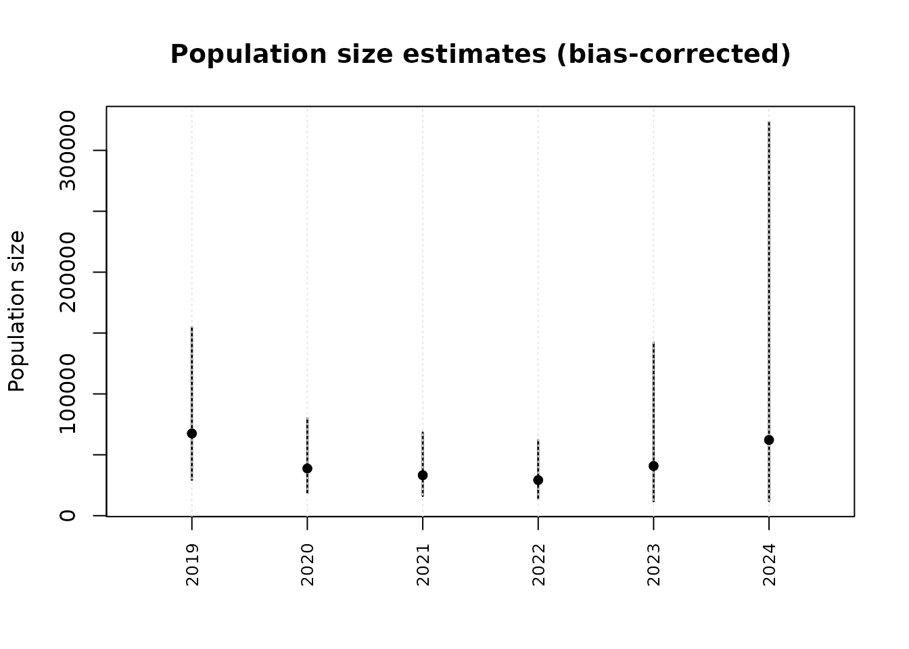
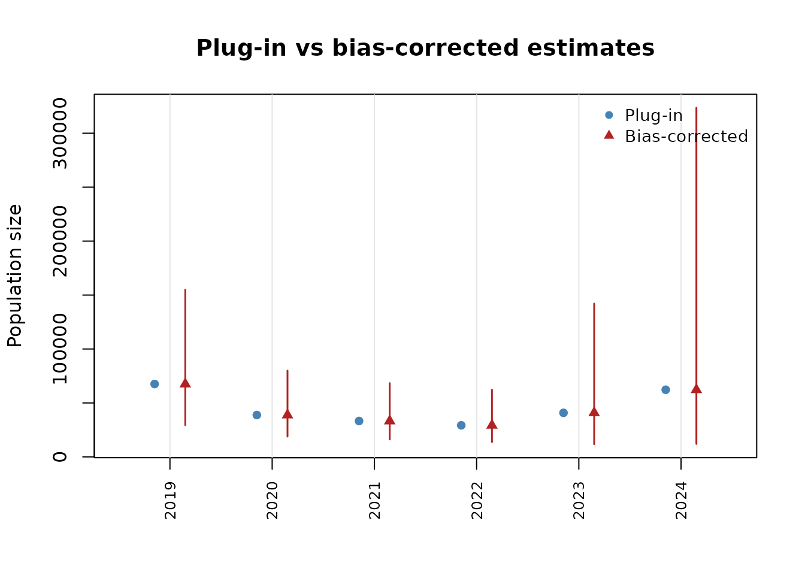
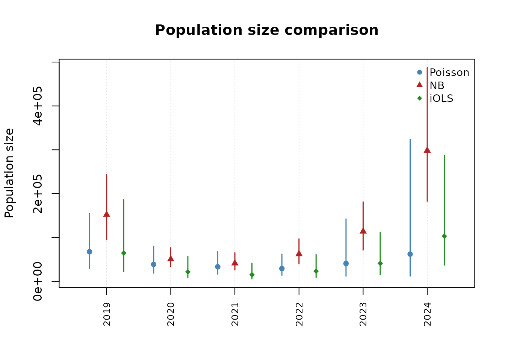

# Model Comparison and Reporting

## Introduction

This vignette demonstrates how to compare estimation methods and present
results using the **uncounted** package’s plotting and reporting tools.

``` r

library(uncounted)
data(irregular_migration)
d <- irregular_migration
```

## Fitting multiple models

The package supports five estimation methods. We fit Poisson, NB, and
iOLS to the same data for comparison:

``` r

fit_po <- estimate_hidden_pop(d, ~ m, ~ n, ~ N,
  method = "poisson", cov_alpha = ~ year + sex,
  gamma = "estimate", countries = ~ country_code)

fit_nb <- estimate_hidden_pop(d, ~ m, ~ n, ~ N,
  method = "nb", cov_alpha = ~ year + sex,
  gamma = fit_po$gamma, countries = ~ country_code)

fit_io <- estimate_hidden_pop(d, ~ m, ~ n, ~ N,
  method = "iols", cov_alpha = ~ year + sex,
  gamma = fit_po$gamma, countries = ~ country_code)
```

`logLik`, `AIC`, `BIC` and `Deviance` from
[`compare_models()`](https://ncn-foreigners.github.io/uncounted/reference/compare_models.md)
are comparable only within one likelihood family: OLS, NLS, iOLS, or
Poisson/NB. A table can mix families to line up response-scale metrics
such as `RMSE`, but it warns, and those likelihood columns must not be
compared across families.

## Coefficient tables with modelsummary

The package provides
[`tidy()`](https://generics.r-lib.org/reference/tidy.html) and
[`glance()`](https://generics.r-lib.org/reference/glance.html) methods
compatible with the **modelsummary** package:

``` r

library(modelsummary)
modelsummary(
  list(Poisson = fit_po, NB = fit_nb, iOLS = fit_io),
  stars = TRUE
)
```

|  | Poisson | NB | iOLS |
|----|----|----|----|
| alpha × (Intercept) | 0.772\*\*\* | 0.867\*\*\* | 0.764\*\*\* |
|  | (0.050) | (0.026) | (0.065) |
| alpha × year2020 | -0.062\*\* | -0.112\*\*\* | -0.116\*\*\* |
|  | (0.022) | (0.016) | (0.024) |
| alpha × year2021 | -0.093\*\*\* | -0.148\*\*\* | -0.169\*\*\* |
|  | (0.023) | (0.019) | (0.026) |
| alpha × year2022 | -0.122\*\*\* | -0.127\*\*\* | -0.141\*\*\* |
|  | (0.025) | (0.018) | (0.028) |
| alpha × year2023 | -0.097\* | -0.077\*\*\* | -0.092\*\*\* |
|  | (0.046) | (0.016) | (0.021) |
| alpha × year2024 | -0.060 | 0.008 | -0.008 |
|  | (0.058) | (0.016) | (0.020) |
| alpha × sexMale | 0.042 | 0.017 | 0.049\* |
|  | (0.038) | (0.012) | (0.023) |
| beta | 0.613\*\*\* | 0.782\*\*\* | 0.638\*\*\* |
|  | (0.122) | (0.032) | (0.071) |
| gamma | 0.006 |  |  |
|  | (0.005) |  |  |
| theta |  | 1.276 |  |
|  |  | (0.107) |  |
| Num.Obs. | 1382 | 1382 | 1382 |
| AIC | 17569.0 | 5304.0 | 925616.0 |
| BIC | 17616.1 | 5351.0 | 925657.9 |
| Log.Lik. | -8775.519 | -2642.981 | -462800.014 |
| method | POISSON | NB | IOLS |
| link_rho | power | power | power |
| \+ p \< 0.1, \* p \< 0.05, \*\* p \< 0.01, \*\*\* p \< 0.001 |  |  |  |

Individual coefficient tables:

``` r

tidy(fit_po, conf.int = TRUE)
#>                term     estimate  std.error statistic      p.value    conf.low
#> 1 alpha:(Intercept)  0.771789738 0.05038585 15.317589 5.834145e-53  0.67303529
#> 2    alpha:year2020 -0.061916450 0.02186133 -2.832236 4.622375e-03 -0.10476388
#> 3    alpha:year2021 -0.093007624 0.02298700 -4.046096 5.207880e-05 -0.13806132
#> 4    alpha:year2022 -0.122298658 0.02471446 -4.948466 7.480046e-07 -0.17073810
#> 5    alpha:year2023 -0.096571663 0.04587242 -2.105223 3.527191e-02 -0.18647995
#> 6    alpha:year2024 -0.059809740 0.05793225 -1.032408 3.018808e-01 -0.17335486
#> 7     alpha:sexMale  0.041776742 0.03766415  1.109191 2.673477e-01 -0.03204363
#> 8              beta  0.613228341 0.12226861  5.015419 5.291795e-07  0.37358627
#> 9             gamma  0.006079854 0.00509778        NA           NA  0.00117540
#>      conf.high
#> 1  0.870544186
#> 2 -0.019069025
#> 3 -0.047953928
#> 4 -0.073859214
#> 5 -0.006663378
#> 6  0.053735379
#> 7  0.115597114
#> 8  0.852870414
#> 9  0.031448563
glance(fit_po)
#>    method estimator link_rho nobs    logLik      AIC      BIC deviance
#> 1 POISSON       MLE    power 1382 -8775.519 17569.04 17616.12 14948.24
#>   df.residual
#> 1        1373
```

## Plotting population size estimates

The
[`popsize()`](https://ncn-foreigners.github.io/uncounted/reference/popsize.md)
function returns an object that can be plotted directly:

``` r

# By year
ps <- popsize(fit_po, by = ~ year)
plot(ps)
```



``` r


# Compare plug-in vs bias-corrected
plot(ps, type = "compare")
```



## Comparing models visually

[`compare_popsize()`](https://ncn-foreigners.github.io/uncounted/reference/compare_popsize.md)
produces side-by-side population size estimates:

``` r

comp <- compare_popsize(fit_po, fit_nb, fit_io,
  labels = c("Poisson", "NB", "iOLS"),
  by = ~ year)

print(comp)
#> Population size comparison: Poisson vs NB vs iOLS 
#> 
#>      model group  estimate estimate_bc      lower     upper
#> 1  Poisson  2019  67534.06    67501.51  29389.013 155039.36
#> 2  Poisson  2020  38788.92    38768.03  18791.578  79980.51
#> 3  Poisson  2021  33244.44    33226.38  16151.996  68350.21
#> 4  Poisson  2022  29250.00    29233.51  13739.366  62200.69
#> 5  Poisson  2023  40827.27    40806.18  11715.814 142127.95
#> 6  Poisson  2024  62219.57    62189.72  11951.368 323608.29
#> 7       NB  2019 156154.45   151940.91  94763.904 243616.38
#> 8       NB  2020  51793.26    50485.14  33139.284  76910.22
#> 9       NB  2021  42115.80    41156.61  25989.731  65174.46
#> 10      NB  2022  63784.61    62250.21  39947.529  97004.47
#> 11      NB  2023 116487.09   113771.08  71416.833 181243.81
#> 12      NB  2024 305473.48   298228.29 182539.366 487237.98
#> 13    iOLS  2019  65726.44    64593.69  22412.989 186157.44
#> 14    iOLS  2020  21993.21    21666.34   8246.148  56927.22
#> 15    iOLS  2021  15440.65    15242.81   5641.337  41185.83
#> 16    iOLS  2022  23648.76    23327.87   8886.347  61238.83
#> 17    iOLS  2023  41610.77    41049.95  15116.168 111476.55
#> 18    iOLS  2024 104596.78   103144.08  37059.641 287069.74
plot(comp)
```



## Predictions

The [`predict()`](https://rdrr.io/r/stats/predict.html) method supports
new data:

``` r

# Fitted values
head(predict(fit_po))
#> [1]  3.2830565  0.3537656  2.3654877  2.2143885 21.0717385  0.8117464

# Log-scale (linear predictor)
head(predict(fit_po, type = "link"))
#> [1]  1.1887748 -1.0391206  0.8609842  0.7949763  3.0479327 -0.2085673

# Predictions for new data
new_d <- d[1:10, ]
predict(fit_po, newdata = new_d)
#>  [1]  3.2830565  0.3537656  2.3654877  2.2143885 21.0717385  0.8117464
#>  [7]  3.9495460  2.1481703  0.4920260 84.9176526
```

## Model selection guidance

| Situation                      | Recommended method             |
|--------------------------------|--------------------------------|
| Default analysis               | Poisson (robust, well-studied) |
| Overdispersion suspected       | NB, then LR test vs Poisson    |
| Sensitivity to large countries | iOLS alongside Poisson         |
| Quick exploration              | OLS with fixed gamma           |

When Poisson and iOLS agree, the result is robust to the choice of
weighting. When they diverge, report both and discuss which observations
drive the difference.

## References

- Santos Silva, J. M. C. & Tenreyro, S. (2006). The Log of Gravity.
  *Review of Economics and Statistics*, 88(4), 641–658.
  <https://doi.org/10.1162/rest.88.4.641>
- Benatia, D., Bellégo, C. & Pape, L.-D. (2025). Dealing with Logs and
  Zeros in Regression Models. arXiv:2203.11820v3.
  <https://arxiv.org/abs/2203.11820>
- Zhang, L.-C. (2008). *Developing methods for determining the number of
  unauthorized foreigners in Norway* (Documents 2008/11). Statistics
  Norway.
  <https://www.ssb.no/a/english/publikasjoner/pdf/doc_200811_en/doc_200811_en.pdf>
- Beręsewicz, M. & Pawlukiewicz, K. (2020). Estimation of the number of
  irregular foreigners in Poland using non-linear count regression
  models. arXiv:2008.09407. <https://arxiv.org/abs/2008.09407>
